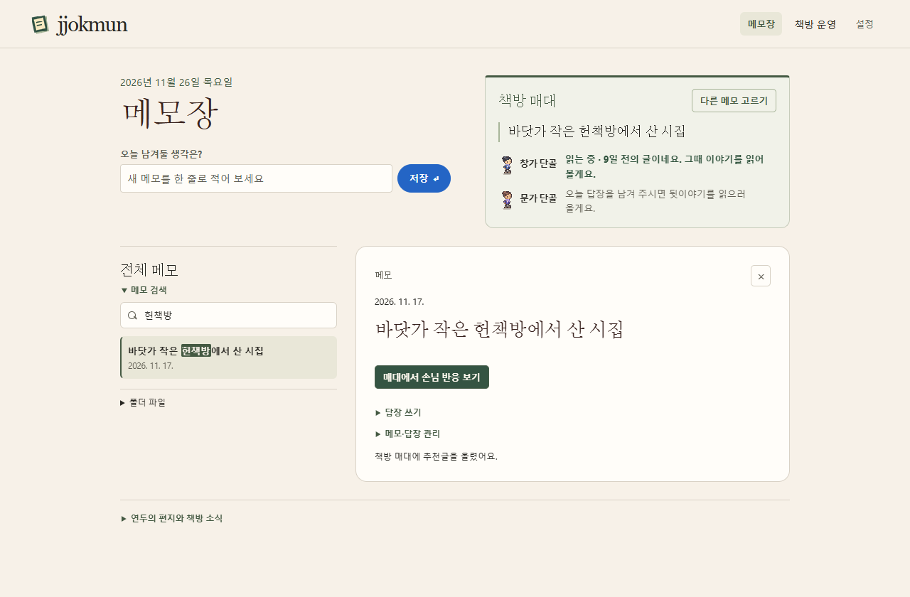

# jjokmun

쪽문은 작은 책방이 있는 오프라인 메모장입니다. 저장 폴더를 열고 떠오른 생각을 한 줄 적으세요. Enter를 누르면 저장한 글이 바로 열립니다.

손님에게 권하고 싶은 글은 **전체 메모**에서 열고 **매대에 놓기**를 누르세요. **책방 매대**에서 그 글과 손님들의 반응을 함께 볼 수 있습니다. 마음이 바뀌면 글을 골라 **이 글로 교체하기**를 누르세요.



**책방 운영**에서는 가구를 옮기고 손님들이 어디서 책을 발견하는지 지켜볼 수 있습니다. 연두의 부탁은 메모장 아래 **연두의 편지와 책방 소식**에 있습니다. [가구를 옮기는 화면](docs/shop-layout.png)

첫 화면에서 **메모 저장 폴더 선택**을 눌러 책방을 여세요. 메모와 책방 설정은 지정한 폴더에 저장하며, 새 탭을 열거나 새로고침하면 마지막으로 연 폴더에 자동으로 연결합니다. Chrome이 권한을 다시 요청하면 **다시 연결**을 눌러 허용하세요. **전체 메모 → 폴더 파일**에서 하위 폴더의 문서와 소스 코드를 상대 경로로 찾아 읽을 수 있습니다.

## 설치와 업데이트

처음 설치할 때는 `chrome://extensions`에서 개발자 모드를 켜고 **압축해제된 확장 프로그램 로드**에서 이 저장소의 `extension` 폴더를 선택하세요.

이전 버전을 같은 확장 카드에서 업데이트하면 기존 프로필 기록을 이전할 수 있습니다. 먼저 기존 탭을 닫고 확장을 새로고침한 다음, 쪽문 저장 파일이 없는 폴더를 선택하세요.

잠금, 암호화 백업, 가져오기 되돌리기 방법은 [확장 사용 안내](extension/README.md)에 있습니다.

## 보안 회귀 테스트

Node.js와 Chrome for Testing을 사용합니다. PowerShell에서 이 저장소를 기준으로 실행하세요.

```powershell
cd tests
npm install
npx playwright-core install chromium
npm test
```

이미 Chrome for Testing이 있다면 브라우저 설치 단계 대신 환경 변수 `MEMO_CHROME_PATH`에 실행 파일 경로를 지정할 수 있습니다. 테스트는 임시 Chrome 프로필에 가상 메모를 만들며, 네트워크 차단 검사는 루프백 서버에 접속합니다.
