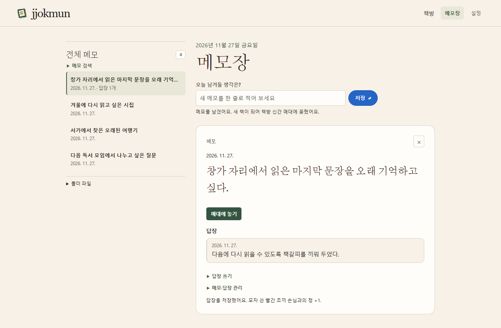

# 쪽문 1.8.0

기존 문서 폴더를 쪽문의 메모장으로 쓸 수 있습니다. 저장 폴더를 선택하면 하위 폴더의 문서가 **전체 메모**에 경로와 함께 나타납니다.

- **메모 목록을 왼쪽으로 옮겼습니다.** 긴 문서를 아래로 스크롤해도 목록이 본문을 가리지 않습니다. 좁은 화면에서는 목록을 접거나 펼칠 수 있습니다.
- **새 메모는 Markdown 파일로 저장됩니다.** 일반 저장소에서 작성한 메모는 `.md` 파일이 됩니다. 기존 Markdown·텍스트 문서는 원래 위치에서 편집할 수 있습니다. 다른 앱에서 같은 파일을 수정했을 때는 두 내용을 비교하고 초안을 별도 메모로 저장할 수 있습니다.
- **다이어그램을 오프라인에서 읽을 수 있습니다.** `.md`와 `.markdown` 문서의 제목, 목록, 표와 함께 Mermaid·PlantUML 코드 블록을 렌더링합니다. 독립 다이어그램 파일(`.mmd`, `.mermaid`, `.puml`, `.plantuml`)도 열 수 있습니다. **원문 보기**로 전환하면 소스를 확인할 수 있습니다.

기존 JSON 백업과 암호화 저장소도 계속 사용할 수 있습니다. 저장소 암호화를 켜면 쪽문 안의 메모와 답장은 암호화 저장 파일에 보관되며, 폴더에 이미 있던 원본 문서는 그대로 남습니다.

