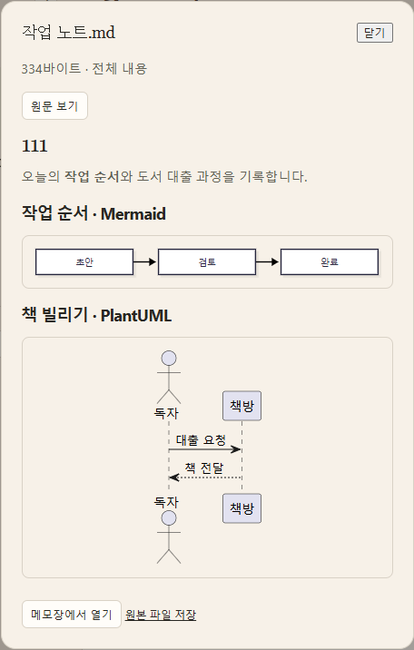

# 쪽문 1.8.1

이제 **전체 메모 → 폴더 파일**에서 Markdown 문서를 열면 제목, 목록, 표와 다이어그램이 바로 보입니다. **원문 보기**를 누르면 작성한 Markdown을 확인할 수 있습니다.

- 메모장과 폴더 미리보기에서 줄 첫머리의 `#111`과 `# 111`을 모두 **111**이라는 1단계 제목으로 표시합니다. 메모 목록에도 제목이 표시되고, 파일에는 입력한 원문이 보존됩니다.
- Markdown 안의 Mermaid·PlantUML 코드 블록과 독립 다이어그램 파일(`.mmd`, `.mermaid`, `.puml`, `.plantuml`)을 폴더 미리보기에서도 오프라인으로 렌더링합니다.

