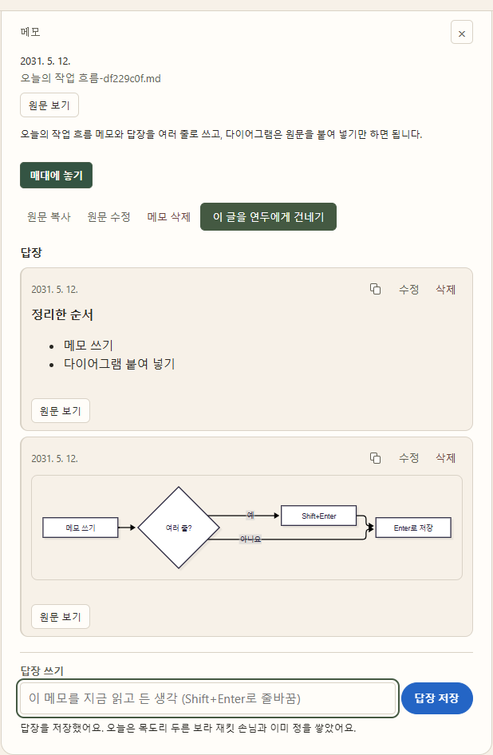
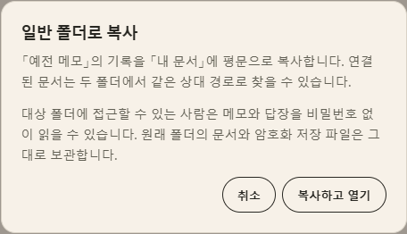

# 쪽문 1.9.0

> **여러 줄 답장을 쓰기 전에 모든 기기의 쪽문을 1.9.0으로 업데이트해 주세요.**
> 일반 폴더에 여러 줄 답장을 한 번이라도 저장하면, 쪽문 1.8.1 이하는 그 폴더를 열지 못하고 "jjokmun에서 내보낸 올바른 JSON 백업 파일을 선택해 주세요."라는 오류를 표시합니다. 메모와 답장은 폴더에 그대로 남아 있으므로, 그 기기의 쪽문을 업데이트하면 다시 열 수 있습니다.
> 1.9.0부터는 저장 파일에 저장한 쪽문의 버전을 기록합니다. 그래서 다음 버전부터는 더 새로운 쪽문이 저장한 폴더를 열 때, 업데이트가 필요하다는 안내가 표시됩니다.

메모와 답장을 여러 줄로 쓸 수 있습니다. Enter로 저장하고 Shift+Enter로 줄을 바꾸세요. 메모장과 책방에서 새 메모를 저장하면 Markdown 첫 줄의 들여쓰기와 마지막 줄바꿈이 파일에도 그대로 남습니다. Mermaid와 PlantUML 원문은 형식에 맞는 파일로 저장하고 미리보기에서 바로 읽을 수 있습니다.

답장도 렌더링됩니다. 답장에 쓴 Markdown 목록과 강조, Mermaid·PlantUML 다이어그램이 답장마다 표시되고, 각 답장의 **원문 보기**로 작성한 내용을 확인할 수 있습니다. 서식이 없는 한 줄 답장은 이전과 같이 보입니다. 다이어그램을 그리지 못하면 "PlantUML 2번째 줄을 해석하지 못했습니다."처럼 문제가 있는 줄을 알려 주고, 그 줄과 엔진의 오류 보고를 함께 표시합니다.

메모를 열면 답장 입력란과 복사·수정·삭제 버튼이 바로 보입니다. 답장 입력란 위의 단골 안내를 없앴습니다. 연두에게 건넬 한 줄을 쓸 때 문장 중간에 여러 줄을 붙여 넣어도 앞뒤 단어의 경계가 유지됩니다.

새 메모는 일반 폴더의 문서로 저장합니다. 기존 암호화 저장소는 비밀번호로 연 뒤 **일반 폴더로 복사**를 선택하세요. 쪽문은 빈 대상 폴더에 평문 사본을 쓰고, 메모 본문과 답장을 다시 읽어 확인합니다. 원래 암호화 저장소와 외부에서 편집한 파일은 그대로 남습니다.

암호화 백업 내보내기와 복원도 계속 사용할 수 있습니다. 예전에 저장한 4 MiB 초과 메모도 원문과 답장을 복구할 수 있습니다. 손상된 저장 파일에 잘못된 버전 번호가 있으면 파일을 확인하라는 안내를 표시합니다.

